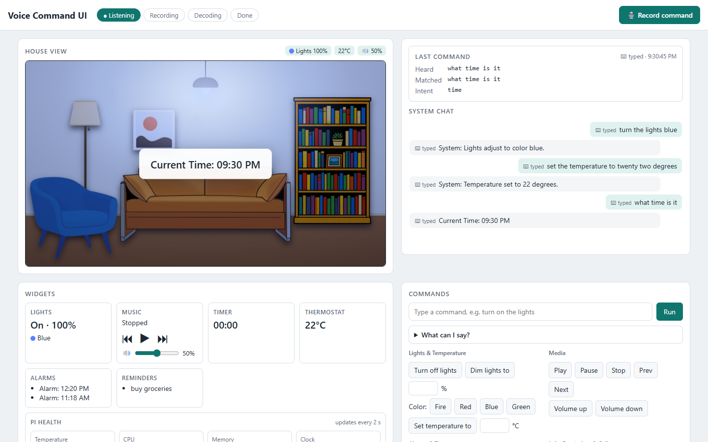
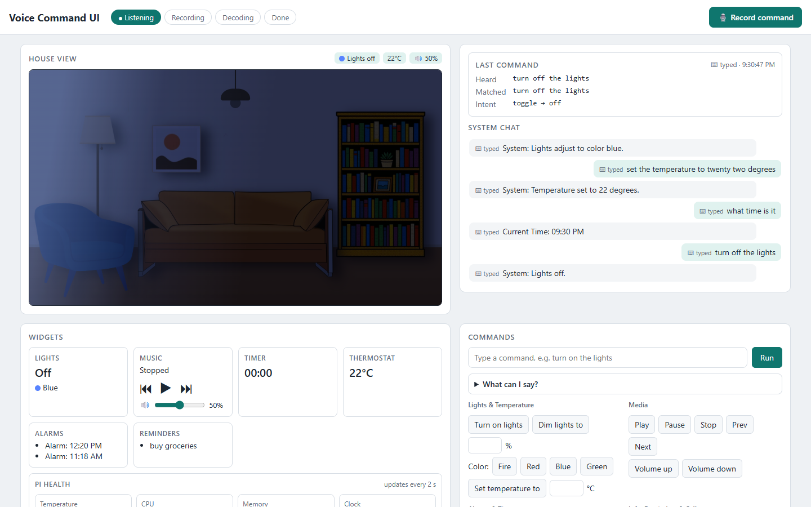
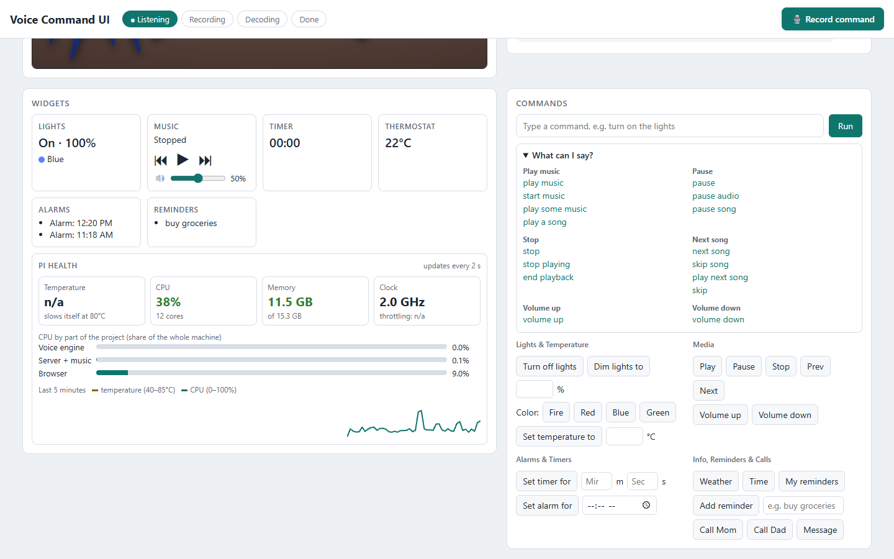

# Raspberry Pi Voice Command Module (VCM)

An offline voice assistant for a **Raspberry Pi 4 (4 GB RAM)**. You say **"Alexa"**, then a short command such as *"turn the lights blue"* or *"set a timer for thirty seconds"*, and a web dashboard on the Pi carries it out. Speech never leaves the device: both deep learning models run locally with ONNX Runtime on the Pi's CPU.

*AI 231 MLOps, Machine Exercise 2, University of the Philippines.*

---

## Contents

1. [What the project does and how the webpage works](#1-what-the-project-does-and-how-the-webpage-works)
2. [Project structure](#2-project-structure)
3. [Model performance](#3-model-performance)
4. [Running it on a Raspberry Pi 4](#4-running-it-on-a-raspberry-pi-4)
5. [The deep learning models](#5-the-deep-learning-models)
6. [Reproducing the training](#6-reproducing-the-training)
7. [Voice command model: data and training](#7-voice-command-model-data-and-training)
8. [Wake word model: data and training](#8-wake-word-model-data-and-training)
9. [References](#9-references)
10. [License](#10-license)

---

## 1. What the project does and how the webpage works

The Pi acts as a small smart-home hub. It listens all the time for the wake word, records the command that follows, turns the audio into text, maps the text to an action, and shows the result on a dashboard of a living room with lights, a thermostat, music, timers, alarms and reminders. The lights and thermostat are simulated on the page; the music really plays through the Pi's speaker.



### From voice to action

```
 microphone (48 kHz)
      │
      ▼
 wake_word_engine.py ── every 0.2 s: last 1.5 s of audio → wake word model ── "Alexa"? ──┐
      │                                                                                   │ yes
      │   beep, then stream the command audio (16 kHz, up to 5 s)                         │
      ▼                                                                                   │
 40-band log-Mel features → voice command model (CTC, 120 tokens, re-run every 80 ms) ◄───┘
      │
      ▼
 beam search + command grammar (intent_parser.py) → stops ~120 ms after you stop talking
      │   POST /voice_result
      ▼
 main_ui.py (Flask) ── runs the action (VLC music, alarms.xlsx, reminders.xlsx, weather)
      │   Server-Sent Events (/events)
      ▼
 index.html ── updates the house view, widgets and chat at once
```

1. **Wake word.** `voice_pipeline/wake_word_engine.py` keeps a rolling microphone buffer and scores the last 1.5 s every 0.2 s with the int8 wake word model. A score above 0.5 counts as "Alexa".
2. **Recording.** The engine beeps, pauses any music so it does not leak into the recording, and streams the command audio into the voice command model.
3. **Transcription.** The voice command model (VCM) outputs one of 120 tokens (118 words, `[UNK]` and the CTC blank) every 40 ms. The engine decodes it with a beam search that only accepts sentences the command grammar allows, so a finished command is recognised as soon as you pause.
4. **Intent.** `voice_pipeline/intent_parser.py` turns the text into an action and value, for example `color → blue` or `timer → {minutes: 0, seconds: 30}`. Anything outside the grammar is rejected ("Didn't catch a command").
5. **Action and display.** The engine posts the result to the Flask server, which carries out the action and pushes it to every open page over Server-Sent Events.

The **Record command** button skips the wake word, and the **Commands** box accepts typed sentences that go through the same grammar. The buttons under it call each action directly, which is handy for testing without a microphone.

| | |
|---|---|
|  |  |
| *"turn off the lights" switches the room to the night scene.* | *"What can I say?" lists the accepted phrasings. The Pi health card shows temperature, CPU, memory and clock speed (captured on the development laptop, so temperature reads n/a).* |

### What you can say

| Command | Example | Values |
|---|---|---|
| Lights on / off | "turn on the lights", "kill the lights" | |
| Brightness | "dim the lights to sixty percent" | 0 to 100 % |
| Light colour | "change the color to red" | red, blue, green |
| Temperature | "set the temperature to twenty two degrees" | 16 to 30 °C |
| Timer | "set a timer for one minute thirty seconds" | 1 to 59 each |
| Alarm | "wake me up at six am" | hour 1 to 12 |
| Reminder | "remind me to drink water", "show my reminders" | drink water, study, exercise, pay bills |
| Music | "play music", "pause", "stop", "next song", "volume up" | |
| Weather / time | "what's the weather", "what time is it" | Quezon City, from wttr.in |
| Call / message | "call mom", "send a message" | mom, dad |

Small words such as *the, a, to, for, my* are optional. Previous song and an exact volume work from the buttons only, because those words are not in the model's vocabulary.

### Server routes

| Route | Method | What it does |
|---|---|---|
| `/` | GET | Serves `index.html` |
| `/events` | GET | Server-Sent Events stream: listening status, voice results, music state and Pi health readings |
| `/parse_text` | POST | Runs typed text through the command grammar |
| `/command` | POST | Carries out one action and returns the message for the chat |
| `/voice_result` | POST | Called by the wake word engine with the decoded text; parses and runs it |
| `/set_status` | POST | Called by the engine: `listening`, `recording`, `decoding` (pauses and resumes music) |
| `/manual_record` | POST | Record command button; the engine picks it up and records without the wake word |
| `/get_data` | GET | Saved alarms and reminders for the widgets |
| `/commands` | GET | Accepted phrasings, for the "What can I say?" list |
| `/ringtone` | GET | Ringtone for the call popup |
| `/get_status`, `/get_voice_result`, `/metrics` | GET | Polling fallback when the event stream drops |

---

## 2. Project structure

Only the files needed to run the webpage and the voice pipeline are in this repository, plus `run_train_pipeline.py`. The training folders (`training_env/` for the voice command model, `training_env_wake/` for the wake word model) and the datasets are not; `run_train_pipeline.py` downloads them (section 6). Sections 7 and 8 describe the data and training. On [Hugging Face](https://huggingface.co/datasets/trueshotjames/ai231-king-me2/tree/v1.0), each of these folders has a `README.md` that says what it holds and where the data that is not stored there comes from.

```
me2-vcm/
├── README.md                      This file
├── main_ui.py                     Flask server: serves the page, runs commands, plays music with VLC,
│                                  fetches the weather, pushes updates to the page over /events
├── index.html                     The dashboard: house view, chat, widgets, command box and buttons
├── pi_metrics.py                  Reads Pi temperature, CPU, memory, clock and throttling for the
│                                  Pi health card (/proc, /sys, vcgencmd; psutil on other systems)
├── run.sh                         Pi / Linux launcher: creates .venv on first run, starts the server
│                                  and the wake word engine, opens the browser, stops both on Ctrl+C
├── run.bat                        Windows launcher: same steps as run.sh; the engine runs in its
│                                  own window, which closes when the server stops
├── .gitattributes                 Keeps CRLF line endings for .bat files and LF for .sh files
├── requirements.txt               Python packages for .venv
├── CHANGE.md                      Log of fixes and the steps they need from you
├── run_train_pipeline.py         One command for the whole training pipeline: downloads the code
│                                  and data, preprocesses, trains, exports and copies the model to
│                                  models/ (section 6)
├── voice_pipeline/
│   ├── wake_word_engine.py        Always-on microphone loop: wake word detection, beep, streaming
│   │                              VCM decoding, end-of-command detection, posts results to Flask
│   ├── intent_parser.py           Command grammar, beam search decoder and text → (action, value)
│   └── benchmark_adapter.py       Writes one JSON line per command when VCM_BENCHMARK=1
│                                  (for the course benchmark harness); idle otherwise
├── models/
│   ├── wake_word_model_quantized.onnx   Wake word model, int8, 57 KB
│   ├── voice_command_model.onnx         Voice command model, fp32, 3.8 MB, CMVN built in
│   └── vocab.txt                        The VCM's 120 output tokens ([UNK] first, CTC blank last)
├── static/
│   └── house_objects/             Sofa, chair, lamp, bookshelf and painting images for the house
│                                  view (.webp, with .png fallbacks)
├── sounds/
│   ├── beep.mp3                   Played when the wake word is heard
│   └── call_ringtone.mp3          Played by the call popup
├── playlist/                      Demo songs (.mp3) for the music commands; add or swap your own
└── screenshots/                   Images used in this README
```

`alarms.xlsx` and `reminders.xlsx` are created next to `main_ui.py` on first start and are not part of the repository.

---

## 3. Model performance

| Model | Size on the Pi | Holdout set | Holdout result | Test / validation result |
|---|---|---|---|---|
| **Voice command model** (causal DS-CNN + CTC) | 0.95 M params, 3.8 MB fp32 ONNX | AI231 ME2 Voice Commands, `holdout` split [[1]](#ref1): 202 clips, 93 command variations plus 16 out-of-scope clips, speakers never used in training | **Intent accuracy 95.5 %** (193 / 202); out-of-scope rejected 11 / 16 | Intent accuracy 96.7 % (4,297 / 4,443, ME2 `test` split); token F1 0.894, precision 0.918, recall 0.880, false alarm rate 0.0008 (integrated test split, 15,713 clips) |
| **Wake word model** (DS-CNN clip classifier) | 33.6 k params, 57 KB int8 ONNX | *TODO* | *TODO* | Validation F1 0.984, precision 0.983, recall 0.985, accuracy 0.987, false alarm rate 0.012 (3,449 clips, best epoch 130) |

How these were measured:

- **VCM intent accuracy** is the share of clips whose decoded text maps to the correct action and value, with the same beam search and grammar the Pi uses (offline decode of 5 s clips on the laptop). On the live streaming path, 1,144 of 1,200 test clips were correct, recording stopped a median 30 ms after speech ended, and decoding took 2.1 ms per 80 ms step.
- **VCM token metrics** come from `training_env/training_results.txt`, best epoch 309, on the speaker-disjoint integrated test split used for early stopping.
- **Wake word metrics** are from the validation split during training, best epoch 130 (`training_env_wake/logs/wake_training_results.txt` on Hugging Face). The holdout evaluation is still to be added.

---

## 4. Running it on a Raspberry Pi 4

### What you need

- Raspberry Pi 4, 4 GB RAM, with a 16 GB or larger microSD card and the official 5 V / 3 A power supply
- A USB microphone that supports 48 kHz (the engine opens the mic at 48 kHz and downsamples to 16 kHz)
- Speakers or headphones on the 3.5 mm jack, HDMI or USB
- A display, or a laptop to view the Pi's desktop over VNC
- Internet only for the weather command; everything else works offline

### 1. Prepare the Pi

Flash **Raspberry Pi OS (64-bit, with desktop)** with Raspberry Pi Imager. In *Edit settings*, set a username, password and hostname, and enable SSH. Boot the Pi and log in.

To use a laptop as the screen instead of a monitor, connect the Pi by Ethernet, enable VNC with `sudo raspi-config` (Interface Options → VNC, then Display Options → VNC Resolution), and connect with a VNC viewer such as TigerVNC.

### 2. Install system packages

```bash
sudo apt update
sudo apt install -y git python3-venv vlc libportaudio2 libsndfile1
```

VLC provides the music player, PortAudio the microphone access and libsndfile the audio file reading.

### 3. Get the code and the Python packages

```bash
git clone https://github.com/trueshotjames/me2-vcm.git
cd me2-vcm
python3 -m venv .venv
source .venv/bin/activate
pip install -r requirements.txt
```

Install the Python packages with pip inside `.venv`, not with apt. Debian's `python3-onnxruntime` package crashes with **"Illegal instruction"** on the Raspberry Pi 4 (the wake word engine dies on start). The PyPI build of `onnxruntime` works. `run.sh` creates `.venv` and installs `requirements.txt` by itself if `.venv` is missing.

`playlist/` comes with three demo songs. Add or replace `.mp3` files there to change what the music commands play.

### 4. Check the microphone and speaker

```bash
arecord -l
arecord -d 3 -r 48000 -f S16_LE test.wav && aplay test.wav
```

If you hear your recording, the engine will hear you too. Set the default input and output devices from the speaker and microphone icons on the desktop taskbar if needed.

### 5. Start everything

```bash
./run.sh
```

`run.sh` starts the server, waits until it answers, starts the wake word engine and opens `http://127.0.0.1:5000/?lite=1` in the default browser. `?lite=1` turns off the page's fade animations, which saves CPU on the Pi. Press `Ctrl+C` in the terminal to stop the server and the engine together.

To start the parts by hand instead, run them from the repository folder (they share `manual_trigger.txt` and the Excel files through the current folder):

```bash
source .venv/bin/activate
python main_ui.py &
python voice_pipeline/wake_word_engine.py &
chromium --kiosk --noerrdialogs --disable-extensions "http://127.0.0.1:5000/?lite=1"
```

On current Raspberry Pi OS the browser command is `chromium` (older releases call it `chromium-browser`). Press `Alt+F4` to leave kiosk mode. On Windows, double-click `run.bat`: it does the same as `run.sh` (creating `.venv` on the first run), with the wake word engine in its own window. To stop, press `Ctrl+C` in the server window and answer `N` to *Terminate batch job?*, so the engine window closes too.

### 6. Use it

1. Wait for the **Listening** badge at the top of the page.
2. Say **"Alexa"**, wait for the beep, then say a command. The badges move through Recording, Decoding and Done.
3. The **Last command** card shows what was heard and which intent it matched, and the chat keeps a history.
4. If the wake word does not trigger in a noisy room, press **Record command**, or type the command in the Commands box.

### Tips for the 4 GB Pi

- Keep only Chromium, the server and the engine running. The two models are only about 4 MB on disk; Chromium uses the most memory.
- Watch the **Pi health** card. If the temperature goes above 80 °C the Pi slows its clock, so use a case with a fan or heatsinks.
- If decoding lags behind speech, raise `DECODE_TICK_MS` from 80 to 120 at the top of `voice_pipeline/wake_word_engine.py`.
- Stop the music before benchmarking, since the microphone picks it up.

---

## 5. The deep learning models

| | Wake word model | Voice command model |
|---|---|---|
| Task | Is the last 1.5 s of audio "Alexa"? | Which words were said? |
| Input | 1.5 s raw waveform, 16 kHz (24,000 samples) | 40-band log-Mel, 25 ms window, 10 ms hop, up to 5 s |
| Architecture | Learned conv front end + 3 depthwise-separable conv blocks + global average pooling + sigmoid | Causal depthwise-separable CNN: 4× subsampling stem + 5 dilated residual blocks + 1×1 conv head |
| Output | One probability (threshold 0.5) | 120 token scores every 40 ms (CTC) |
| Parameters | 33,613 | 951,672 |
| Loss | Binary cross-entropy | CTC |
| Pi format | ONNX, int8 dynamic quantization, 57 KB | ONNX, fp32, CMVN folded into the graph, 3.8 MB |

**Wake word model.** A strided 1-D convolution (40 filters, kernel 256, stride 160, so one frame per 10 ms) learns its own filterbank from the raw waveform. Three depthwise-separable blocks (40 → 64 → 100 → 128 channels, kernels 5, 5, 3, each with batch norm, ReLU and 15 % dropout) follow, then global average pooling and a linear layer with a sigmoid. The design follows the DS-CNN keyword spotters of Zhang et al. [[25]](#ref25). Datasets, preprocessing, augmentation and training details are in [section 8](#8-wake-word-model-data-and-training).

**Voice command model.** The model is causal: every output step only looks at past audio, so the Pi can decode while you are still speaking. A stride-2 convolution and a stride-2 depthwise-separable convolution reduce 10 ms frames to 40 ms steps, two more separable convolutions follow, then five residual blocks with dilations 1, 2, 4, 1 and 2 widen the receptive field to about 1.9 s. All layers use 256 channels and 10 % dropout. The per-band mean and standard deviation from the training set are stored inside the model, so the exported ONNX graph normalises its own input and the Pi only computes the log-Mel features. `features.py` is the same NumPy code in training and on the Pi. Datasets, preprocessing, augmentation and training details are in [section 7](#7-voice-command-model-data-and-training).

---

## 6. Reproducing the training

One command sets up the data, preprocesses, trains, exports and copies the new model into `models/`. The training code, the frozen splits, the Common Voice clips and all wake word clips are published on Hugging Face: [trueshotjames/ai231-king-me2](https://huggingface.co/datasets/trueshotjames/ai231-king-me2), tag `v1.0`, DOI [10.57967/hf/10994](https://doi.org/10.57967/hf/10994). Tag `v0.1-vcm` is the earlier VCM-only version.

### What you need

- A Linux machine with an NVIDIA GPU, an internet connection and plenty of free disk. For the VCM: MUSAN alone is 12 GB, the ME2 wav files about 7 GB, plus the feature cache. For the wake word model: about 1.4 GB of clips plus a 1.6 GB cache.
- Python 3, `ffmpeg` on the PATH (VCM), and the training packages:

  ```bash
  pip install huggingface_hub
  python run_train_pipeline.py --model vcm --only fetch_code
  pip install -r training_env/requirements.txt pyarrow
  python run_train_pipeline.py --model wake --only fetch_wake_code
  pip install -r training_env_wake/requirements.txt
  ```

- VCM only: a free [Mozilla Data Collective](https://mozilladatacollective.com) account for the Philippine Languages Database (see below). The wake word model needs nothing outside the Hugging Face repository.

### Run it

```bash
python run_train_pipeline.py
```

A menu asks which model to train (voice command model, wake word model or both), shows the plan, and asks before it starts. Training settings and GPU numbers are in the `CONFIG` block at the top of `run_train_pipeline.py` (`VCM` and `WAKE`; the `WAKE` values are those of the released wake word model).

| Option | What it does |
|---|---|
| `--model vcm` / `wake` / `all` | Skip the menu (for `nohup` or cluster jobs) |
| `--yes` | Do not ask before starting |
| `--dry-run` | Show the plan and which stages are already done; download or run nothing |
| `--from STAGE`, `--only STAGE` | Start at a stage, or run just one |
| `--force` | Rerun stages even if their output exists |
| `--no-download` | Never use the network: if data is missing, stop with a list of the missing files instead of downloading |
| `--gpus 2,5`, `--epochs`, `--patience`, `--min_epochs`, `--workers` | Override the CONFIG values of the model(s) being run; other options go straight to `train.py` |

Voice command model stages, in order (each is skipped when its output already exists, so a stopped run can simply be restarted):

| Stage | What it does |
|---|---|
| `fetch_code` | Downloads `training_env/` from Hugging Face |
| `fetch_me2` | Downloads the AI231 ME2 Voice Commands parquet files [[1]](#ref1) at the commit the splits were built from |
| `unpack_me2` | Trims clips over 5 s and writes every clip as a wav file |
| `musan` | Downloads MUSAN [[14]](#ref14) from OpenSLR (about 11 GB) |
| `pld` | Downloads the English part of the Philippine Languages Database [[11]](#ref11) |
| `pop_songs` | Optional: the demo playlist used as background music. It is not published; without it, MUSAN music is used instead |
| `build_csv` | The integrated splits are frozen; rebuilt only with `--force` |
| `verify` | Stops if any clip in the splits is missing |
| `preprocess`, `train`, `export` | `preprocess.py`, `train.py`, `export_onnx.py` (section 7) |
| `install` | Copies `voice_command_model.onnx` and `vocab.txt` into `models/` |

Wake word model stages, in order:

| Stage | What it does |
|---|---|
| `fetch_wake_code` | Downloads the `training_env_wake/` code and split CSVs from Hugging Face |
| `fetch_wake_audio` | Downloads the 17,245 wake word clips (about 1.4 GB, already augmented) from Hugging Face |
| `verify` | Stops if any clip in the wake CSVs is missing |
| `preprocess` | `preprocess.py`: decodes every clip to 16 kHz mono, crops to 1.5 s and caches it |
| `train` | `train.py` into `training_env_wake/train_logs/`; exports the int8 ONNX at the end |
| `export` | Re-exports `best_model.pth` to `wake_word_model_quantized.onnx` if `train` did not |
| `install` | Backs up the current `models/wake_word_model_quantized.onnx`, then copies the new one there |

With `--model all`, stage names shared by both models (`verify`, `preprocess`, `train`, `export`, `install`) apply to both in `--from` and `--only`.

### The Philippine Languages Database

Its terms do not allow redistribution, so each user downloads it with their own account:

1. Log in at the [dataset page](https://mozilladatacollective.com/datasets/cmmxhw46c00tqnw07xyr94zjk) and accept the terms.
2. Create an API key in your profile settings.
3. Paste the key when `run_train_pipeline.py` asks for it, or set it first with `export MDC_API_KEY=...`. The key is not stored.

The archive is 45.6 GB, but the script streams it and keeps only the `ENG` folder. It stops once that folder has been read.

### On the course GPU cluster

Everything, including the Philippine Languages Database, is already in place on the cluster, so the download stages are skipped and the cluster's missing internet access does not matter:

```bash
cd "/home/king.james.villasin/sandbox/Machine Exercise 2"
python run_train_pipeline.py --model vcm --yes
python run_train_pipeline.py --model wake --yes     # inside tmux; the wake clips are already in training_env_wake/dataset/
```

---

## 7. Voice command model: data and training

### Datasets

Training data is built from two pools: the class dataset **AI231 ME2 Voice Commands** [[1]](#ref1) and Asian-accented English from the **Philippine Languages Database** [[11]](#ref11) and **Common Voice** [[4]](#ref4). `training_env/dataset/build_integrated_csv.py` merges them into speaker-disjoint train, test and holdout files.

| Source | Clips (train / test / holdout) | Role | License |
|---|---|---|---|
| AI231 ME2 Voice Commands [[1]](#ref1), which contains: | | | Research and education only |
| · MLEnd Spoken Numerals [[8]](#ref8) | 14,146 / 6,032 / 0 | Spoken numbers 0 to 199 for the slotted commands | MLEnd terms |
| · Group synthetic voices (LibriSpeech-cloned [[13]](#ref13), F5-TTS [[16]](#ref16)) | 12,215 / 5,370 / 366 | All 93 command variations, clean and noisy | Group's own |
| · Filipino-accented synthetic voices [[10]](#ref10) (CosyVoice 2 [[15]](#ref15)) | 9,925 / 4,193 / 0 | Filipino accent coverage | Research only |
| · Speech Commands v2 [[3]](#ref3) | 6,010 / 2,577 / 0 | Digits and short words | CC BY 4.0 |
| · SLURP [[2]](#ref2) | 1,013 / 442 / 0 | Real smart-home requests | CC BY 4.0 |
| · Synthetic negatives (DEMAND [[18]](#ref18), MS-SNSD [[17]](#ref17) noise) | 871 / 379 / 0 | Noise, babble, reversed and cut-off speech labelled out of scope | CC BY-SA 3.0 / MIT |
| · Class recordings (AI231 students) | 574 / 260 / 84 | Real Filipino-accented commands | Do not share without consent |
| · Fluent Speech Commands [[5]](#ref5) | 278 / 122 / 9 | Real commands | Non-commercial academic |
| · SNIPS SLU [[6]](#ref6) | 269 / 117 / 0 | Real commands | SNIPS terms |
| · Timers and Such [[7]](#ref7) | 95 / 41 / 0 | Timer and alarm phrasing | See its license |
| · Common Voice 19, English [[4]](#ref4) | 91 / 40 / 3 | General speech, out of scope | CC0 |
| · Multi-Sensor Voice Command [[9]](#ref9) | 11 / 4 / 0 | Real commands | CC BY 4.0 |
| Philippine Languages Database, English [[11]](#ref11) | 409 / 181 / 0 | English read by Tagalog-L1 speakers | CC BY-NC 4.0 |
| Common Voice, Asian-accented English [[4]](#ref4) | 529 / 228 / 0 | Asian accents | CC0 |
| MUSAN noise and music [[14]](#ref14) | used for augmentation | Background noise and music | CC BY 4.0 |
| **Total** | **46,436 / 19,986 / 462** (21.9 h / 9.4 h / 0.3 h) | | |

How the splits are made:

- **Holdout.** The 202 clips of the ME2 holdout split (one real and one synthetic take per variation, plus out-of-scope clips), together with every other clip by those speakers, so no holdout voice is ever heard in training.
- **Train and test.** All other speakers, split 70 / 30 by speaker. The split is greedy and balanced so each command, each source and the out-of-scope class get about 30 % in test.
- **Filtering.** Clips longer than 5 s are trimmed or dropped. Asian-accent clips are kept only if they contain at least one command word. Numerals are limited to 0 to 199.
- **Labels.** Transcripts are lower-cased, digits are written as words ("22" → "twenty two"), "6 am" becomes the tokens `six am`, and every word outside the 118-word vocabulary becomes `[UNK]`.

### Preprocessing

`training_env/preprocess.py` runs once on the CPU and caches everything the GPUs need:

1. Decode each clip to 16 kHz mono and drop clips longer than 5 s.
2. Make the original copy plus 2 augmented copies of every training clip (`--k 2`).
3. Compute 40-band log-Mel features (25 ms window, 10 ms hop, 20 Hz to 8 kHz) with the same code the Pi uses.
4. Compute the per-band mean and standard deviation from the clean training copies (CMVN); these are stored in the model.

### Augmentation

| Augmentation | Setting | Why |
|---|---|---|
| Speed perturbation | ×0.9, ×1.0 or ×1.1 | Fast and slow speakers |
| Room reverb | 50 % of copies, synthetic impulse response, RT60 0.2 to 0.8 s | Small rooms |
| Background | 80 % of copies: MUSAN noise at 0 to 20 dB SNR (60 %) or music (40 %, half of it pop songs like the demo playlist) at low, medium or high volume | The Pi plays music while it listens |
| Gain | −20 to +20 dB | Near and far speakers, mic levels |
| SpecAugment [[24]](#ref24) | 2 frequency masks (up to 8 bands) and 2 time masks (up to 200 ms), drawn fresh every batch on the GPU | Robustness to missing bands and short dropouts |

### Training

| Setting | Value |
|---|---|
| Hardware | 2 × NVIDIA A100-SXM4-40GB (GPUs 6 and 7 of DGX node `n002`), PyTorch DDP, bf16 |
| Run | 12 October 2026: epochs 1 to 271 (early stop), then resumed from the epoch 271 checkpoint for epochs 272 to 459 |
| Wall-clock | About 1 h 51 min in total: preprocessing about 6 min, epochs 1 to 271 1 h 06 min, epochs 272 to 459 39 min (sum of the per-epoch times in the log, 12 to 15 s each); about 3.5 A100-hours |
| Seed | 1234 (the default of `train.py` and `preprocess.py`; the run did not override it) |
| Batch | 256 clips per GPU |
| Optimiser | AdamW, weight decay 1e-4, peak learning rate 0.002 × √(GPUs) = 0.00283 |
| Schedule | One-cycle (SGDR warm restarts also available) |
| Loss | CTC [[23]](#ref23), blank = token 119 |
| Model selection | Best token F1 on the test split, with early stopping |
| Result | Best epoch 309 of 459, F1 0.894 |

`run_train_pipeline.py` runs these steps (section 6). By hand, from `training_env/`:

```bash
python preprocess.py --workers 32
python train.py --gpus 2,5 --epochs 300 --patience 30 --min_epochs 60 --fresh
python export_onnx.py
```

`export_onnx.py` writes the ONNX model and checks that it gives the same output as PyTorch.

The seed fixes the weight initialisation, the batch order of every epoch (`seed + epoch`) and the augmentation of every clip (`seed`, row id). Runs are close but not bit-identical, because `cudnn.benchmark`, TF32 and DDP gradient reduction are not deterministic. Pass `--seed N` to `train.py` and `preprocess.py` to change it.

The logs of this run (`vcm_train.log`, `vcm_training_results.txt`) are in [`training_env/logs/`](https://huggingface.co/datasets/trueshotjames/ai231-king-me2/tree/main/training_env/logs) on Hugging Face. The trained weights (ONNX and PyTorch checkpoint) are attached to the [`v0.1-vcm` release](https://github.com/trueshotjames/me2-vcm/releases/tag/v0.1-vcm).

---

## 8. Wake word model: data and training

This describes the deployed wake word model (`models/wake_word_model_quantized.onnx`, release `v1.0`). `run_train_pipeline.py --model wake` reproduces it (section 6); the code, splits, clips and logs are in `training_env_wake/` on [Hugging Face](https://huggingface.co/datasets/trueshotjames/ai231-king-me2/tree/v1.0/training_env_wake).

### Datasets

All clips are already augmented, so they are published as they are and used without further augmentation.

| Source | Clips (train / validation) | Label | License |
|---|---|---|---|
| SynTTS-Commands, "Alexa" [[19]](#ref19): CosyVoice 2 [[15]](#ref15) clones of VoxCeleb [[20]](#ref20) [[21]](#ref21) voices | 5,796 / 1,449 | 1 (wake) | MIT |
| SynTTS-Commands [[19]](#ref19), 15 other spoken commands such as "Hey Google" and "Volume up", same cloned voices (`speech-noise-dataset/VoxCeleb12_English/`) | 5,600 / 1,400 | 0 (not wake) | MIT |
| Speech Noise Dataset [[22]](#ref22): noise and noisy speech (`speech-noise-dataset/noise_chopped/`) | 2,400 / 600 | 0 (not wake) | CC0 |
| **Total** | **13,796 / 3,449** (4.54 h / 1.14 h) | | |
| Holdout set | *TODO* | | |

### Preprocessing

`training_env_wake/preprocess.py` runs once on the CPU (32 workers, 15 s on the cluster) and caches every clip:

- Each clip is converted to mono and resampled to 16 kHz (soundfile and scipy, the same resampler the Pi engine uses).
- Clips longer than 1.5 s are cropped. Shorter clips are stored as they are; `train.py` places each one at a random offset in the 1.5 s window, padded with silence, redrawn every epoch, so the model learns to detect "Alexa" anywhere in the window. Validation clips get a fixed placement, so validation F1 is comparable between epochs.
- The model works on the raw waveform, so there is no separate feature step: the first convolution learns the filterbank.

### Training and export

| Setting | Value |
|---|---|
| Hardware | 2 × NVIDIA A100-SXM4-40GB (GPUs 0 and 6 of DGX node `ai-n002.hpc.coe.upd.edu.ph`), PyTorch 2.13 DDP, CUDA 13.0 |
| Run | 15 October 2026, 16:30 to 16:33 (UTC+8), one run, no resume |
| Wall-clock | About 1 min 41 s in total: preprocessing 15 s, training 86 s (180 epochs, about 0.25 s each with the whole cache in GPU memory) |
| Seed | 1234 |
| Batch | 256 clips per GPU (512 per step, 26 steps per epoch) |
| Optimiser | AdamW, weight decay 1e-4, peak learning rate 0.002 × √(GPUs) = 0.00283 |
| Schedule | One-cycle: warmup over the first 10 % of steps, then cosine decay |
| Loss | Binary cross-entropy |
| Model selection | Best validation F1; at most 500 epochs, at least 50, early stop after 50 without improvement |
| Result | Best epoch 130 of 180: F1 0.984, precision 0.983, recall 0.985, accuracy 0.987, false alarm rate 0.012 (TP 1,427, FP 24, TN 1,976, FN 22) |
| Export | ONNX, then int8 dynamic quantization (`QUInt8`), 57 KB; input `[1, 24000]`, output `[1, 1]` |

`run_train_pipeline.py --model wake` runs these steps with the same settings (the `WAKE` block). By hand, from `training_env_wake/`:

```bash
python -u preprocess.py --workers 32
python -u train.py --gpus 0,6 --fresh --out_dir train_logs --epochs 500 --min_epochs 50 --patience 50 \
  --batches 256 --lr 0.002 --seed 1234 --ckpt_every 500
```

`train.py` exports `train_logs/wake_word_model_quantized.onnx` at the end. The cluster guide with every step is `training_env_wake/WAKE_TRAINING_STEPS.md`.

The logs of this run (`wake_train.log`, `wake_training_results.txt`, `wake_results.json`, `wake_preprocess_report.txt`) are in [`training_env_wake/logs/`](https://huggingface.co/datasets/trueshotjames/ai231-king-me2/tree/v1.0/training_env_wake/logs) on Hugging Face. The weights (int8 ONNX and PyTorch checkpoint) are attached to the [`v1.0` release](https://github.com/trueshotjames/me2-vcm/releases/tag/v1.0).

On the Pi, the engine downsamples the 48 kHz microphone stream to 16 kHz and scores the latest 1.5 s every 0.2 s.

---

## 9. References

**Voice command datasets**

1. <a id="ref1"></a>airimonda. (2026). *AI231 ME2 Voice Commands* [Dataset]. Hugging Face. DOI: [10.57967/hf/10723](https://doi.org/10.57967/hf/10723). https://huggingface.co/datasets/airimonda/ai231-me2-voice-commands
2. <a id="ref2"></a>Bastianelli, E., Vanzo, A., Swietojanski, P., & Rieser, V. (2020). SLURP: A spoken language understanding resource package. *EMNLP 2020*. DOI: [10.18653/v1/2020.emnlp-main.588](https://doi.org/10.18653/v1/2020.emnlp-main.588). https://github.com/pswietojanski/slurp
3. <a id="ref3"></a>Warden, P. (2018). Speech Commands: A dataset for limited-vocabulary speech recognition. arXiv:1804.03209. DOI: [10.48550/arXiv.1804.03209](https://doi.org/10.48550/arXiv.1804.03209)
4. <a id="ref4"></a>Ardila, R., et al. (2020). Common Voice: A massively-multilingual speech corpus. *LREC 2020*, 4218–4222. DOI: [10.48550/arXiv.1912.06670](https://doi.org/10.48550/arXiv.1912.06670). https://commonvoice.mozilla.org · Kaggle copy used for the Asian-accented clips: https://www.kaggle.com/datasets/mozillaorg/common-voice
5. <a id="ref5"></a>Lugosch, L., Ravanelli, M., Ignoto, P., Tomar, V. S., & Bengio, Y. (2019). Speech model pre-training for end-to-end spoken language understanding. *Interspeech 2019*. DOI: [10.21437/Interspeech.2019-2396](https://doi.org/10.21437/Interspeech.2019-2396). https://fluent.ai/fluent-speech-commands-a-dataset-for-spoken-language-understanding-research/
6. <a id="ref6"></a>Saade, A., et al. (2018). Spoken language understanding on the edge. arXiv:1810.12735. DOI: [10.48550/arXiv.1810.12735](https://doi.org/10.48550/arXiv.1810.12735). https://github.com/sonos/spoken-language-understanding-research-datasets
7. <a id="ref7"></a>Lugosch, L., Papreja, P., Ravanelli, M., Heba, A., & Parcollet, T. (2021). Timers and Such: A practical benchmark for spoken language understanding with numbers. arXiv:2104.01604. DOI: [10.48550/arXiv.2104.01604](https://doi.org/10.48550/arXiv.2104.01604). Data DOI: [10.5281/zenodo.4623772](https://doi.org/10.5281/zenodo.4623772)
8. <a id="ref8"></a>MLEnd Datasets, Queen Mary University of London. *MLEnd Spoken Numerals* [Dataset]. No DOI. https://www.kaggle.com/datasets/jesusrequena/mlend-spoken-numerals
9. <a id="ref9"></a>*Multi-Sensor Voice Command* [Dataset]. KU Leuven Research Data Repository. CC BY 4.0. DOI: [10.48804/IEKKVZ](https://doi.org/10.48804/IEKKVZ)
10. <a id="ref10"></a>martinnavs. *ai231-fil-supplemental-data* [Dataset]. Hugging Face. No DOI. https://huggingface.co/datasets/martinnavs/ai231-fil-supplemental-data
11. <a id="ref11"></a>Guevara, R. C., Cajote, R., Bayona, M. G., & Lucas, C. R. (2024). Philippine Languages Database: A multilingual speech corpora for developing systems for low-resource languages. *SIGUL 2024 @ LREC-COLING 2024*, 264–271. No DOI. https://aclanthology.org/2024.sigul-1.32 (CC BY-NC 4.0, research use only)

**Noise, voices and tools used to build the data**

12. <a id="ref12"></a>Pratap, V., et al. (2024). Scaling speech technology to 1,000+ languages (MMS). *JMLR* 25(97). https://jmlr.org/papers/v25/23-1318.html (forced aligner)
13. <a id="ref13"></a>Panayotov, V., Chen, G., Povey, D., & Khudanpur, S. (2015). LibriSpeech: An ASR corpus based on public domain audio books. *ICASSP 2015*. DOI: [10.1109/ICASSP.2015.7178964](https://doi.org/10.1109/ICASSP.2015.7178964). https://www.openslr.org/12/
14. <a id="ref14"></a>Snyder, D., Chen, G., & Povey, D. (2015). MUSAN: A music, speech, and noise corpus. arXiv:1510.08484. DOI: [10.48550/arXiv.1510.08484](https://doi.org/10.48550/arXiv.1510.08484). https://www.openslr.org/17/
15. <a id="ref15"></a>Du, Z., et al. (2024). CosyVoice 2: Scalable streaming speech synthesis with large language models. arXiv:2412.10117. DOI: [10.48550/arXiv.2412.10117](https://doi.org/10.48550/arXiv.2412.10117)
16. <a id="ref16"></a>Chen, Y., et al. (2024). F5-TTS: A fairytaler that fakes fluent and faithful speech with flow matching. arXiv:2410.06885. DOI: [10.48550/arXiv.2410.06885](https://doi.org/10.48550/arXiv.2410.06885)
17. <a id="ref17"></a>Reddy, C. K. A., et al. (2019). A scalable noisy speech dataset and online subjective test framework (MS-SNSD). *Interspeech 2019*. DOI: [10.21437/Interspeech.2019-3087](https://doi.org/10.21437/Interspeech.2019-3087). https://github.com/microsoft/MS-SNSD
18. <a id="ref18"></a>Thiemann, J., Ito, N., & Vincent, E. (2013). The Diverse Environments Multi-channel Acoustic Noise Database (DEMAND). *Proc. Meetings on Acoustics* 19, 035081. DOI: [10.1121/1.4799597](https://doi.org/10.1121/1.4799597). Data: DOI [10.5281/zenodo.1227121](https://doi.org/10.5281/zenodo.1227121)

**Wake word datasets**

19. <a id="ref19"></a>Gan, L., & Li, X. (2025). SynTTS-Commands: A public dataset for on-device KWS via TTS-synthesized multilingual speech. arXiv:2511.07821. DOI: [10.48550/arXiv.2511.07821](https://doi.org/10.48550/arXiv.2511.07821). https://huggingface.co/datasets/lugan/Syntts-Commands-Media-Dataset
20. <a id="ref20"></a>Nagrani, A., Chung, J. S., & Zisserman, A. (2017). VoxCeleb: A large-scale speaker identification dataset. *Interspeech 2017*, 2616–2620. DOI: [10.21437/Interspeech.2017-950](https://doi.org/10.21437/Interspeech.2017-950)
21. <a id="ref21"></a>Chung, J. S., Nagrani, A., & Zisserman, A. (2018). VoxCeleb2: Deep speaker recognition. *Interspeech 2018*, 1086–1090. DOI: [10.21437/Interspeech.2018-1929](https://doi.org/10.21437/Interspeech.2018-1929)
22. <a id="ref22"></a>abdullahhaydarkadolu. *Speech Noise Dataset* [Dataset]. Kaggle. No DOI. https://www.kaggle.com/datasets/abdullahhaydarkadolu/speech-noise-dataset

**Models and methods**

23. <a id="ref23"></a>Graves, A., Fernández, S., Gomez, F., & Schmidhuber, J. (2006). Connectionist temporal classification. *ICML 2006*. DOI: [10.1145/1143844.1143891](https://doi.org/10.1145/1143844.1143891)
24. <a id="ref24"></a>Park, D. S., et al. (2019). SpecAugment: A simple data augmentation method for automatic speech recognition. *Interspeech 2019*. DOI: [10.21437/Interspeech.2019-2680](https://doi.org/10.21437/Interspeech.2019-2680)
25. <a id="ref25"></a>Zhang, Y., Suda, N., Lai, L., & Chandra, V. (2017). Hello Edge: Keyword spotting on microcontrollers. arXiv:1711.07128. DOI: [10.48550/arXiv.1711.07128](https://doi.org/10.48550/arXiv.1711.07128)

---

## 10. License

The code in this repository is under the [MIT License](LICENSE).

The trained models (`models/*.onnx` and the weights in the [releases](https://github.com/trueshotjames/me2-vcm/releases)) are under [CC BY-NC 4.0](https://creativecommons.org/licenses/by-nc/4.0/), because their training data includes non-commercial and research-only sources (section 7). The training code, data splits and logs on [Hugging Face](https://huggingface.co/datasets/trueshotjames/ai231-king-me2) are CC BY-NC 4.0; the wake word clips there keep their own licenses (SynTTS-Commands clips MIT, Speech Noise Dataset clips CC0), listed in its `LICENSE.md`. The demo songs in `playlist/` belong to their artists and are not covered by either license.
